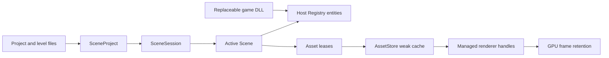

# Scene and asset development workflow

The Windows samples use reusable host-owned scene services and a versioned project catalog. Add supported assets and scenes through files, then save to observe them in a development session. Game rules remain in the sample/game code. The 3D codec supports hierarchical authoring and explicit save/load. Prefabs, general component reflection and additional import formats remain later work.

## Project data

[Content/Project.ravenproject](../Content/Project.ravenproject) is UTF-8 text with a `raven-project 1` header. Blank lines and `#` comments outside quoted paths are allowed. Paths are Content-relative; use forward slashes and quotes around paths containing spaces. Existing asset UUIDs remain stable when their paths change.

```text
raven-project 1
texture 7a590cee-ec82-4a27-927f-860e64619c19 "Textures/UVGrid.png" srgb
mesh 6938c6b9-72ca-4bc1-b0bf-9dc31e158087 "Meshes/Cube.fbx"
audio ef451c5a-02db-4d81-89a1-ec2ea98ed719 "Audio/CourtyardWin.wav"
scene 78e12fa6-6bc9-4ad6-953c-ec8f45ad4180 perspective "Levels/Perspective.ravenscene"
```

Records use UUIDv4 identities in one namespace. `texture` requires a PNG and `srgb` or `linear`; `mesh` requires a single-object static FBX; `audio` requires the existing 16-bit PCM WAV format. `perspective` scenes use binary `.ravenscene` files; `orthographic` scenes retain `.ravenlevel` text files. The scene-record order determines F4 order within that family. The sample has no C++ asset-registration list or fixed level-path array.

The catalog rejects duplicate/nil identities, unsupported versions/records/settings, incorrect source extensions, rooted paths, parent escapes, paths escaping through physical links, and missing source files. Scene codecs validate component values, named bindings and typed asset references when loading a scene. Inactive scene files are not instantiated during catalog loading. Materials and lighting keep their existing level records; this format does not introduce material-asset serialization or arbitrary component factories.

Both codecs accept `win-sound UUID`; Orthographic also accepts `loss-sound UUID`. The existing sample cue IDs remain defaults for older level files. An explicit nil UUID is invalid. Resource acquisition checks the actual catalog type, including audio references.

## Hierarchical 3D authoring

The current 3D runtime uses [versioned binary scenes and a save/export tool](InteractionGame.md#live-binary-authoring). F4 order is Perspective, Gallery, Assemblies, Puzzle, Collection. The earlier flat and hierarchical text files were migrated with authored identities intact. RavenSceneTool handles legacy text conversion. The DLL owns gameplay rules and animation in free-fly, and standalone orbit keeps its visual demonstration controls.

Authored entity IDs remain immutable scene-scoped names, independent of runtime handles. Full local/world composition, reparent/detach and cascade destruction retain the contracts below. See [the binary schema and persistence policy](InteractionGame.md#binary-format-and-persistence) for bounds, authored component fields and runtime exclusions.

### Runtime hierarchy contract

[Scene](../RavenEngine/Public/Raven/Scene/Scene.hpp) retains parent relationships in host-owned metadata. Components remain copied ECS values; no module-owned objects, pointers or callbacks enter retained state. `SetParent(child, parent)` validates live ownership and ancestry before changing anything. Null parent detaches. Reparent/detach preserves local TRS, so world pose can change; there is no lossy world-TRS decomposition. Same names in another Scene do not grant ownership. `DestroyEntity` cascades through the owned subtree and clears removed camera/selection/gameplay bindings. Direct Registry destruction of a parent leaves an invalid ancestry: world evaluation rejects it until the child is detached/reparented or its owned subtree is destroyed. Scene destruction remains generation-safe.

World transforms are computed from current Registry local values as `parentWorld * T * Rz * Ry * Rx * S`. Nested rotation/nonuniform scale can create shear; complete matrices go directly to the renderer. Mesh rendering, inverse-transpose normals, transformed AABBs and frustum culling all use that same model matrix. Runtime parent edits affect descendants on the next gathered frame without F3 or cached-transform invalidation. DLL writes remain local, and the host never writes its bound arm's rotation in free-fly.

Camera world position uses the complete affine ancestor chain. Camera axes use only ancestor/local rotations, ignoring scale and reflection, producing a rigid right-handed view for rendering and picking. Inherited scale/reflection can move the camera's local offset but never mirrors/skews its lens. Free-fly displacement and orbit controls remain local to the camera parent; inherited scale changes world travel distance. Use a rigid camera rig for ordinary controls. Picking consumes the exact presented view/projection/viewport.

### Explicit save API

`PerspectiveLevel::GetAuthoringDefinition()` exposes a const authored snapshot. Copy it, edit authored values, then call the sample codec's explicit writer:

```cpp
auto edited = level.GetAuthoringDefinition();
edited.Groups[1].Transform.Position.X -= 0.5f;
PerspectiveLevel::Save(edited, absoluteLevelPath, project);
```

`SceneDocument::Encode()` validates the schema and emits canonical binary version 1 for base scenes or version 2 for scenes with pickups. `Save` also checks asset types and source existence against the current project, then calls `Files::WriteAtomic`. Current tool commands and binary details are in [InteractionGame.md](InteractionGame.md). A same-directory exclusively created temporary file is flushed and closed before replacement through the native backend. Windows uses same-volume MoveFileExW replacement with bounded sharing retries. Failed writes or replacements remove the temporary file and preserve the destination. See [Microsoft's replacement options](https://learn.microsoft.com/en-us/windows/win32/api/winbase/nf-winbase-movefileexw).

The saved snapshot includes IDs, parent bindings, group/mesh/camera local transforms, mesh UUIDs/tints, named material definitions/assignments and texture UUIDs, global lighting, camera projection/clipping, orbit target, controlled/beacon bindings/radius and audio UUID. It excludes runtime entity/mesh/texture handles, derived matrices, live DLL rotation, moved camera pose/zoom, host animation, F6 swaps, beacon outcome/tint, pointers, callbacks and GPU/DLL state. Explicitly changing the copied authored definition is how a caller persists an intended edit. General component serialization and an editor UI are deferred.

Save does not publish a scene or write on every frame/reload. With `--watch-game`, the existing settled watcher prepares and publishes the saved bytes once, restarting the authored attempt automatically. The accepted watcher is seeded from those bytes; publication does not resave, preventing reload loops. Invalid/superseded candidates leave the current scene active and corrected saves recover. Compatible DLL/asset replacement keeps the same hierarchy, local values, entity handles, camera selection and mesh handles.

## Source roots and staging

With `--watch-game`, both sample families watch the project catalog and active scene automatically. Development data comes directly from the source `Content` directory configured by CMake. The host logs `Scene content root`, `Watching project`, `Watching scene`, and each acquired asset's absolute watch path. These paths are independent of the process working directory.

`--watch-mesh` enables workers for acquired FBX resources. `--watch-game` or `--watch-wall` enables workers for acquired PNG resources. A mesh/wall development option also selects source Content. `--watch-shader` retains its configured HLSL source watcher. Unreferenced asset records do not start workers. Scene/catalog watching follows `--watch-game`; F3 remains available for an explicit restart.

Without the asset/scene development options, the samples read executable-relative staged Content. `cmake/RavenContent.cmake` discovers Content files automatically and stages them with validated shaders and dependency licenses. A newly created source asset can be used immediately in development; the next host build stages it for ordinary execution. Do not full-build a host while it is running.

## Scene and resource ownership

[SceneProject](../RavenEngine/Public/Raven/Scene/SceneProject.hpp) owns the committed catalog, scene list and an [AssetStore](../RavenEngine/Public/Raven/Assets/AssetStore.hpp). Its constructor accepts an explicit Content root for another game/project. The sample adapter selects the configured source root or staged root.

[SceneSession](../RavenEngine/Public/Raven/Scene/SceneSession.hpp) owns an active scene and the host's codec factory. The existing sample codecs produce [Scene](../RavenEngine/Public/Raven/Scene/Scene.hpp) instances. Scene owns its entity handles and names, selected camera, explicit gameplay bindings, and asset leases. Entity destruction and constructor rollback affect only those owned handles, including when Registry slots have been reused. A destroyed camera selection remains a stale value that camera preparation can reject; F2 can switch to the other authored camera.

AssetStore keeps weak cache entries. Scenes and other explicit application owners hold `AssetLease` values. Acquiring the same UUID in the same store shares its resource. A candidate scene acquires its dependencies while the outgoing scene still holds its leases, preserving shared runtime identities during switching. Releasing the last lease stops the source worker and releases the managed resource. Expired cache entries are pruned. The 3D diagnostic quads have explicit application leases for their two grid textures; those resources remain owned while the quads exist.

Project/session operations, resource access and final lease release run on the main/rendering thread. Worker decoders retain only owned CPU snapshots, not leases or Registry references.

GameInstance and Registry outlive the active scene. The renderer outlives the project and every asset lease. Scene factories belong to the retained host client; game-DLL callbacks and objects never enter retained scene/ECS state. Game code continues to borrow Registry and explicit GameBindings during its synchronous update. AssetLease and other ownership objects are not ComponentValue fields. Audio playback retains shared PCM data until its backend voice is stopped or destroyed.



## Runtime handles and GPU retirement

A persistent AssetId identifies authored content. MeshHandle and TextureHandle identify a runtime slot, renderer context and generation. Reuse advances the generation; null, foreign, released and stale handles fail resolution. Identity-preserving source replacements keep the active handle and texture descriptor while swapping the uploaded contents.

`CreateManagedMesh` and `CreateManagedTexture` are released through their matching APIs. Release invalidates the handle immediately. Submitted frame slots retain the exact mesh buffers and texture objects until their fences complete. `CollectResources` polls completed slots; normal frame and asset-store processing calls it automatically. Non-rendering clients can call it explicitly after retiring scenes. Individual descriptor sets are freed after GPU use and their pool capacity is reused. Empty descriptor pages and slot metadata retain peak capacity, while live resources, bindings, cache entries and workers return to the current owners' needs.

Legacy services remain standalone and do not participate in SceneProject catalog transactions. Legacy `CreateMesh`, `CreateMeshHandle`, `CreateTexture`, and `AssetResources` preserve their context-lifetime borrowed-reference contract. Their resources are pinned and the managed release APIs refuse to release them. A reference obtained from a managed lease is borrowed only while a lease keeps that resource live. Runtime handles can become stale after the last owner leaves; persistent asset references remain the authored identity.

## Publication and recovery

Project and scene source bytes settle on workers. PNG/FBX workers also decode immutable snapshots. Scene codecs and GPU preparation run on the host before publication. A candidate owns all newly acquired dependencies and entities until it is accepted. Source bytes are checked again after preparation; superseded candidates are discarded. Prepared metadata updates commit resource contents into existing runtime identities without replacing the scene.

| Edit | Successful result | Failed result |
| --- | --- | --- |
| Active level save or F3 | New authored attempt, owned entities/bindings replaced, outcome reset and old cue stopped | Current attempt stays active |
| F4 | Next valid scene in the current family's catalog order | Current scene stays active |
| Asset path/color-space metadata | Prepared contents and workers replace existing contents; UUID, runtime handle, entity pose and selection stay | Previous catalog/resources stay active |
| Catalog scene-path change for the active ID | Prepare the new scene and dependencies, then publish together | Previous catalog and scene stay active |
| PNG/FBX save | Existing runtime resource receives new contents; gameplay state stays | Last good resource stays active |
| Compatible game DLL | Update code changes; scene, entities, selection, values and attempt outcome stay | Active DLL stays on build/contract failure |

Removing or changing the type of the active scene is rejected until the user switches away. Removing or changing the kind of a leased asset is rejected while an owner still needs it. Correcting a failed dependency retries without requiring another metadata/level save. Dependency-blocked scene/project candidates retry at 200 ms; project parse/source failures retry after settling with duplicate diagnostics suppressed. Newly saved snapshots supersede pending work. WAV clips load through scene ownership; live WAV source watching is not part of this version.

## Complete launch commands

Build through CMake Tools or a Visual Studio developer environment before launching.

```powershell
# Debug 3D
Set-Location -LiteralPath 'D:\RavenEngine'
& 'D:\RavenEngine\out\build\x64-debug\RavenEngine\RavenEngine.exe' --watch-game --free-fly --watch-mesh

# Release 3D
Set-Location -LiteralPath 'D:\RavenEngine'
& 'D:\RavenEngine\out\build\x64-release\RavenEngine\RavenEngine.exe' --watch-game --free-fly --watch-mesh

# Debug 2D
Set-Location -LiteralPath 'D:\RavenEngine'
& 'D:\RavenEngine\out\build\x64-debug\RavenEngine\RavenEngine.exe' --orthographic --watch-game --watch-wall --watch-shader

# Release 2D
Set-Location -LiteralPath 'D:\RavenEngine'
& 'D:\RavenEngine\out\build\x64-release\RavenEngine\RavenEngine.exe' --orthographic --watch-game --watch-wall --watch-shader
```

Game-only builds while running:

```powershell
cmake -P 'D:\RavenEngine\out\build\x64-debug\RavenEngine\GameBuild\BuildGame.cmake'
cmake -P 'D:\RavenEngine\out\build\x64-release\RavenEngine\GameBuild\BuildGame.cmake'
```

## Repeatable authoring check

1. Start either development command and note its absolute watch paths.
2. Copy a supported mesh and PNG into new source paths under Content. Choose new UUIDv4 IDs and add their metadata records.
3. Copy a level in the matching family, reference the new IDs in its mesh/material or sprite records, and append a scene record with a new UUID. Save the catalog. The active scene keeps its state.
4. Press F4 to reach the new scene. Change and save its values; the authored attempt restarts automatically. F3 is optional.
5. Save malformed scene/metadata/asset data. The last good world remains visible. Correct the data and verify automatic recovery. Test creating a previously missing referenced file without resaving the catalog.
6. Switch repeatedly between scenes with shared and exclusive assets. Check renderer/store diagnostics and watch logs: shared resources persist, exclusive handles expire, and counts stay bounded after frame completion.
7. Edit a game function body, verify replacement and preserved scene state, then check failed-build and incompatible-DLL recovery. Shared-definition changes still require a host rebuild/restart.

Restore validation data before staging or packaging. Native macOS/Linux execution and tracked regression integration remain open; CTest is deferred. Local executable probes and capture-based evidence are under ignored `out/validation/scene-workflow/`.


## Windows verification — 2026-11-19

Both Windows presets build and run the shared services. The focused probes are local ignored artifacts, not registered CTest tests or a regression suite available from a clean checkout.

| Check | Debug and Release evidence |
| --- | --- |
| Data-only authoring | Stock sessions created new FBX/PNG/level files during play, published metadata, and displayed the added F4 scene without sample source edits or a host rebuild/restart |
| Scoped lifetime | 100 managed-resource cycles; shared lease identity, stale handles after slot reuse, prepared-upload supersession, texture handle/descriptor retention, released mesh buffers and bounded slots/pools |
| Scene ownership | Actual sample codecs exercised 60 switches per family across shared/exclusive resources, candidate rollback, owned-only destruction, stale-camera switching and restart |
| Validation/recovery | Format/version/UUID/type/path/Unicode checks; duplicate/missing metadata, malformed PNG/FBX/scene, missing active level, corrected dependencies without resaving metadata, and superseded scene snapshots |
| DLL state | Both families retained entity/player/camera selection, pose/lens, resource identity and completion through compatible replacement, incompatible rejection and valid recovery; stock failed builds retained pixels and recovered |
| Rendering/controls | Existing Perspective/Gallery pixels match pre-milestone captures; F6/T, orbit, F2/Home, resize and minimize/restore pass; 2D PNG and both shader passes recover exact pixels after rejected edits |
| Audio | Endpoint loopback captured the two expected 3D win cues; restart, Courtyard completion and scene-owned audio playback pass |
| GPU/header integrity | Core/synchronization validation is clean; traced resources balance at shutdown; 24 shared-resource switches allocate no additional buffers/images/descriptors; eight new/changed public headers compile independently |

The stock 3D timing samples measured level lighting activation at 0.174 s Debug / 0.212 s Release, material activation at 0.236 s / 0.235 s, and game source edit/build/activation at 2.552 s / 2.738 s. These are single local observations with screenshot capture enabled, not performance guarantees. Initial resource acquisition and catalog-dependent decode/upload remain synchronous on the host; subsequent watched PNG/FBX decoding runs on workers.

Current local validation commands, after building both hosts and with no running sample during preparation:

```powershell
Set-Location -LiteralPath 'D:\RavenEngine'
python 'D:\RavenEngine\out\validation\scene-workflow\prepare-probes.py'
python 'D:\RavenEngine\out\validation\scene-workflow\prepare-reload-probes.py'
cmd.exe /d /c 'D:\RavenEngine\out\validation\scene-workflow\x64-debug-probes.cmd'
cmd.exe /d /c 'D:\RavenEngine\out\validation\scene-workflow\x64-release-probes.cmd'
cmd.exe /d /c 'D:\RavenEngine\out\validation\scene-workflow\x64-debug-reload-probes.cmd'
cmd.exe /d /c 'D:\RavenEngine\out\validation\scene-workflow\x64-release-reload-probes.cmd'
cmd.exe /d /c 'D:\RavenEngine\out\validation\scene-workflow\x64-debug-orthographic-reload.cmd'
cmd.exe /d /c 'D:\RavenEngine\out\validation\scene-workflow\x64-release-orthographic-reload.cmd'
python 'D:\RavenEngine\out\validation\scene-workflow\run-probes.py' x64-debug
python 'D:\RavenEngine\out\validation\scene-workflow\run-probes.py' x64-release
python 'D:\RavenEngine\out\validation\scene-workflow\reload-state.py' x64-debug
python 'D:\RavenEngine\out\validation\scene-workflow\reload-state.py' x64-release
python 'D:\RavenEngine\out\validation\scene-workflow\live.py' x64-debug
python 'D:\RavenEngine\out\validation\scene-workflow\live.py' x64-release
python 'D:\RavenEngine\out\validation\scene-workflow\live-2d.py' x64-debug
python 'D:\RavenEngine\out\validation\scene-workflow\live-2d.py' x64-release
python 'D:\RavenEngine\out\validation\scene-workflow\play.py' x64-debug
python 'D:\RavenEngine\out\validation\scene-workflow\play.py' x64-release
```

The live scripts temporarily change repository input files and restore their saved bytes in cleanup. Run these validations serially so they do not share mutable source inputs. Pixel/trace/audio helpers use the installed Vulkan SDK layers and local Python/Windows endpoint tools. The manual authoring check above remains usable without those ignored probes.

Native macOS/Linux execution, a tracked automated regression suite, general component/asset serialization, prefabs, import dependency/build-output metadata and live WAV watching remain open. Legacy pinned resources intentionally retain renderer lifetime. Descriptor pages and runtime slot arrays retain peak capacity; the tests verify bounded reuse and released live objects/bindings, not return of every allocation page to the OS after each scene switch.

## Historical hierarchical 3D validation — 2026-11-19

This record describes the text writer before binary migration. Its ignored probes target that earlier API and are historical evidence. Current runnable checks and commands are recorded in [InteractionGame.md](InteractionGame.md).

Windows Debug and Release builds and 3D-only native probes pass: nested local/world propagation, nonuniform scale/reflection/shear, inverse-transpose normals, transformed AABBs, rigid parented-camera rays, cycle/self/stale/cross-scene rejection, local-preserving detach/reparent, cascade destruction and binding cleanup. Version 1/2 flat files remain readable; version 3 writer round trips retain authored IDs, parents, local transforms, materials/assets, lighting, camera settings and gameplay/audio bindings. Invalid saves, locked-destination replacement failure, Unicode paths and temporary-file cleanup pass. Live saves publish once, restart authored state, reject invalid/superseded candidates and recover without F3.

Both configurations verify real DLL-controlled child rotation and descendant movement, host-controlled second-arm propagation, compatible/incompatible DLL replacement, retained camera pose/selection, hierarchy, completion tint and mesh handles, malformed FBX retention/recovery, 30 scene switches with bounded slots/descriptors and zero remaining scene-owned assets/workers/entities after retirement. The renderer's one pinned white-texture binding remains its baseline. Stock 3D sessions show root/lighting edits, FBX changes and last-good pixels, DLL-only speed edits, intentional failed game builds and valid recovery, T/F6, ground picking, standalone orbit/Home, resize/minimize/restore and normal shutdown. Vulkan core/synchronization validation reports no warnings/errors. Screenshots and native sources/logs are local under ignored `out/validation/scene-hierarchy/`; they are not a tracked regression suite.

Temporary production level/FBX/game-source edits were restored. Existing workspace edits were preserved. The Perspective codec now retains material names for saving, separates file parsing/writing from runtime behavior, and removes its unused adapter constructor. All existing command-line options still have callers and remain supported. No 2D runtime tests were run; CTest stays deferred. Native macOS/Linux execution, general component/asset serialization, multi-camera authoring, prefabs, editor UI, multi-object FBX/import dependencies, broader physics and additional rendering features remain outside this milestone. Atomic saves promise visibility on the supported local filesystem, not power-loss durability or concurrent-writer conflict resolution.

The complete native probe commands below use ignored local validation sources. Run from a Visual Studio development environment after the full host builds, with no host running during those builds. `prepare.py` refreshes isolated Content/runtime copies, and each generated command file initializes its own toolchain. The live scripts then use the real source Content root and restore their edits.

```powershell
Set-Location -LiteralPath 'D:\RavenEngine'
python 'D:\RavenEngine\out\validation\scene-hierarchy\prepare.py'
cmd.exe /d /c 'D:\RavenEngine\out\validation\scene-hierarchy\x64-debug-probes.cmd'
cmd.exe /d /c 'D:\RavenEngine\out\validation\scene-hierarchy\x64-release-probes.cmd'
python 'D:\RavenEngine\out\validation\scene-hierarchy\run-probes.py'
python 'D:\RavenEngine\out\validation\scene-hierarchy\live.py' x64-debug
python 'D:\RavenEngine\out\validation\scene-hierarchy\live.py' x64-release
```

Save-to-activation observations for this run are recorded in each configuration's `live-timings.json`; these are local single-save timings, not latency guarantees. Game edits include polling, background compilation/linking, validation and activation. Level edits require no C++ compilation. Screenshot assertions compare settled rendered frames, including unchanged images through invalid edits and failed builds. See [complete launch commands](#complete-launch-commands) for ordinary use.
